<div align="center">

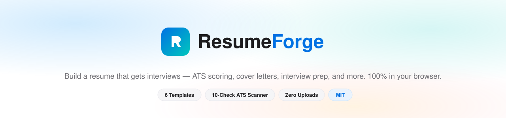

[](https://resumeforge-ruby-rho.vercel.app)


**The complete, privacy-first career toolkit.** Build, score, and export a resume · scan any PDF against ATS checks · match job descriptions · write cover letters · negotiate salary · prep interviews · track applications. All of it runs entirely in your browser — nothing is ever uploaded.

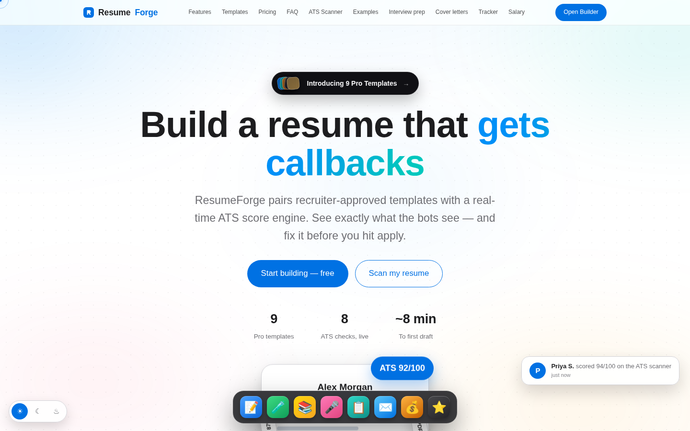

</div>

---

## Table of Contents

- [Live Demo](https://resumeforge-ruby-rho.vercel.app)
- [About](#about)
- [The Landing Experience](#the-landing-experience)
- [Pages & Features](#pages--features)
- [Three Themes](#three-themes)
- [The Scoring Engines](#the-scoring-engines)
- [Architecture](#architecture)
- [Getting Started](#getting-started)
- [Testing](#testing)
- [Roadmap](#roadmap)
- [License](#license)

---

## About

ResumeForge is a monetization-ready career product (Free / Pro $9mo / Lifetime $49 tiers) that covers the entire job-application loop in one place:

| Area | What you get |
| --- | --- |
| **Build** | Live resume builder, 9 recruiter-approved templates, one-click PDF |
| **Score** | 8-check real-time ATS engine + 10-check full-text scanner with PDF upload |
| **Match** | Job-description keyword matcher with live coverage % |
| **Write** | Cover letter studio with 3 tone presets |
| **Negotiate** | Offer analyzer, counter-range math, and 4 ready-to-send scripts |
| **Prep** | 48 curated interview questions across 6 role tracks |
| **Track** | Application pipeline tracker with JSON export/import |

Everything is client-side: no accounts, no tracking, no servers touching your career data.

---

## The Landing Experience

The homepage is a full interaction showcase — 15+ hand-built components powered by locally vendored GSAP + ScrollTrigger:

### Drag to compare

A draggable BEFORE/AFTER slider morphs a wall-of-text resume (ATS 34/100) into a forged one (ATS 92/100):

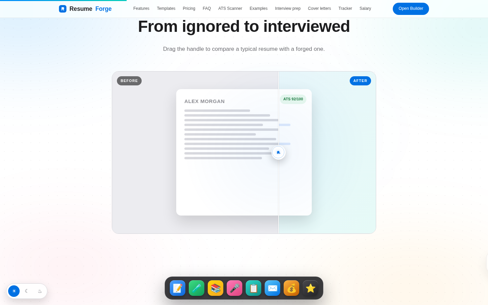

### Wall of wins

Three infinite testimonial columns drift at different speeds and pause on hover:

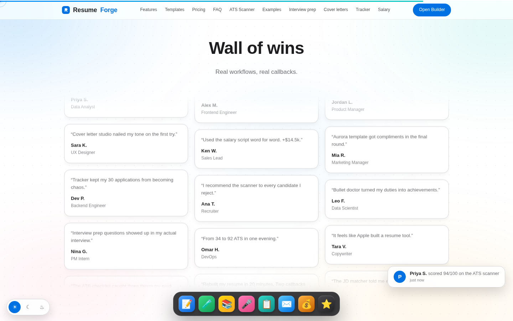

### Kinetic type & logo strip

"FITS YOUR WORKFLOW" flips in letter by letter, followed by a brace-wrapped tech-stack strip — plus a live social-proof toast sliding in bottom-right:

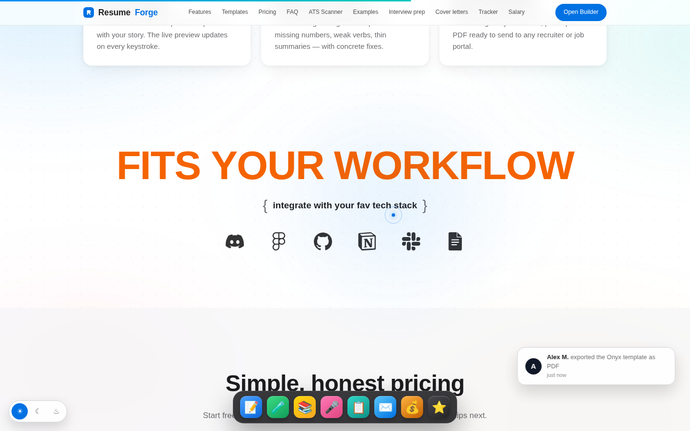

### Giant marquee ribbons

Two opposite-direction bands of 6rem kinetic type:

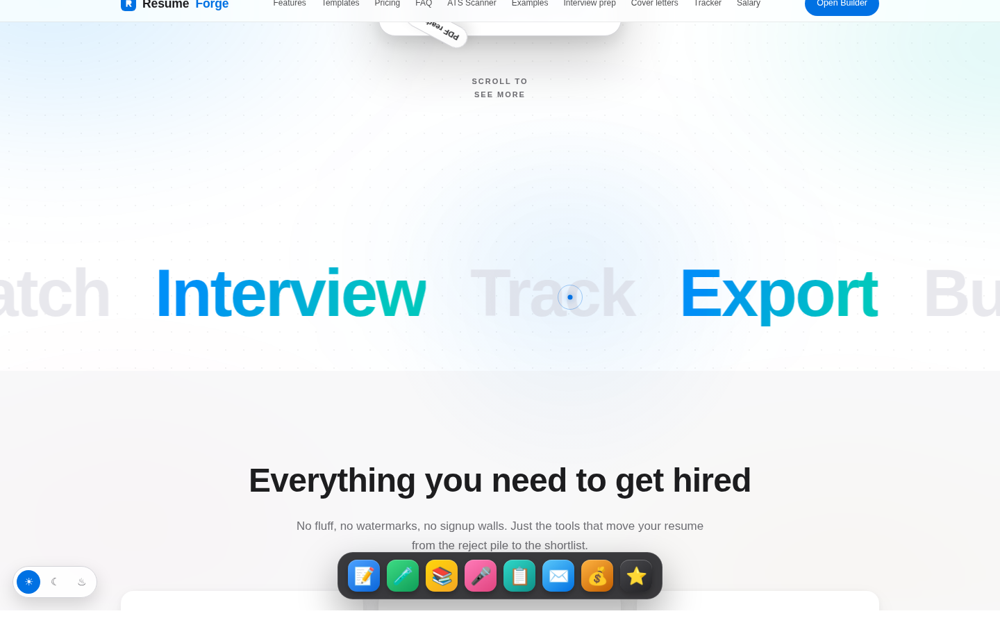

### The black ATS band

Shimmer-dot status pills (Parsing · Scoring · Matching) with live count-up timers, and a score meter that fills to 92 exactly when you reach it:

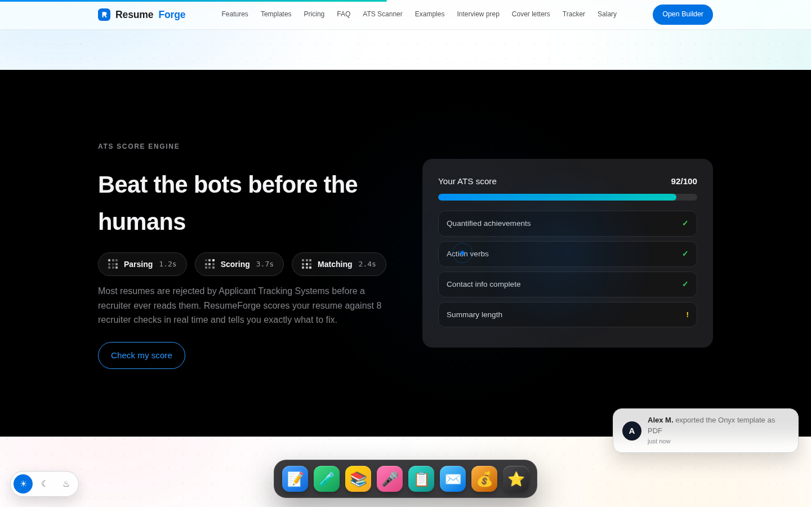

**Also on the page:** an announcement pill whose stacked template icons fan out on hover · a hero headline that rotates interviews → callbacks → offers → noticed → hired on a 3D axis · orbiting status chips around the hero card · cursor-tracking spotlight on all 26 cards · shine sweeps across primary buttons · a macOS-style dock with proximity magnification · a draggable mechanical keyboard with toss physics (builder page) · scroll-cue line · gradient scroll-progress bar · title-scramble decode on every tool page · custom cursor with magnetic buttons.

---

## Pages & Features

### Resume Builder — with a real mechanical keyboard

Live preview across nine templates, ATS re-scored on every keystroke, per-bullet **Bullet Doctor**, JD keyword matching — plus a draggable, throwable mechanical keyboard that physically presses as you type. Toss it away and recall it from the corner **⌨** key.

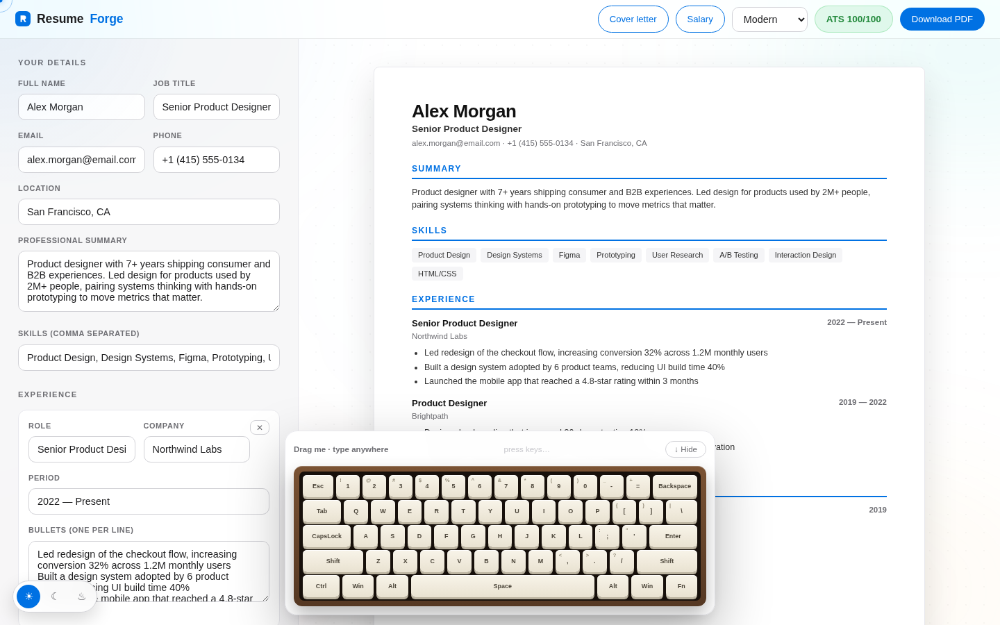

### ATS Scanner — upload & score

Drop a PDF/TXT resume (or paste text) for an animated score ring, 10 weighted checks, document stats, and optional JD keyword coverage. PDF text extraction runs locally via vendored pdf.js.

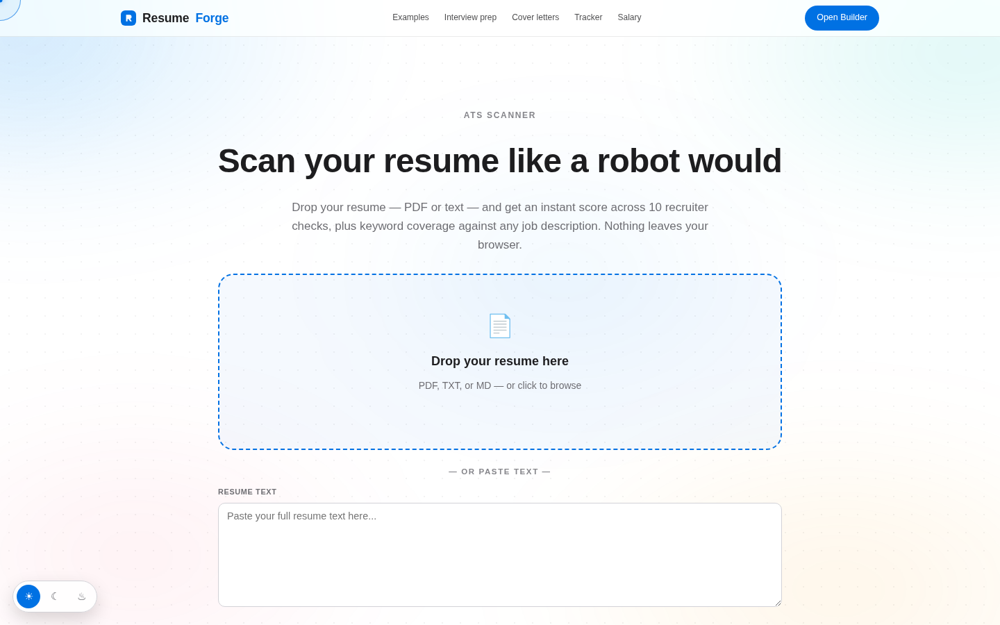

### Salary Negotiation studio

Analyze an offer against your current salary and market rate, get a verdict with a precise counter range, then generate a personalized script for 4 scenarios — counter, competing offer, benefits, or more time:

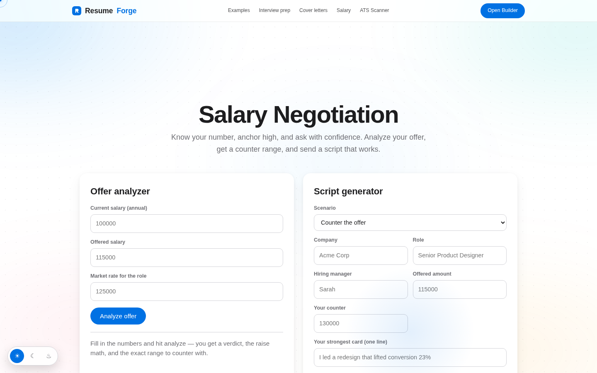

### The rest of the toolkit

| | |
| --- | --- |
| 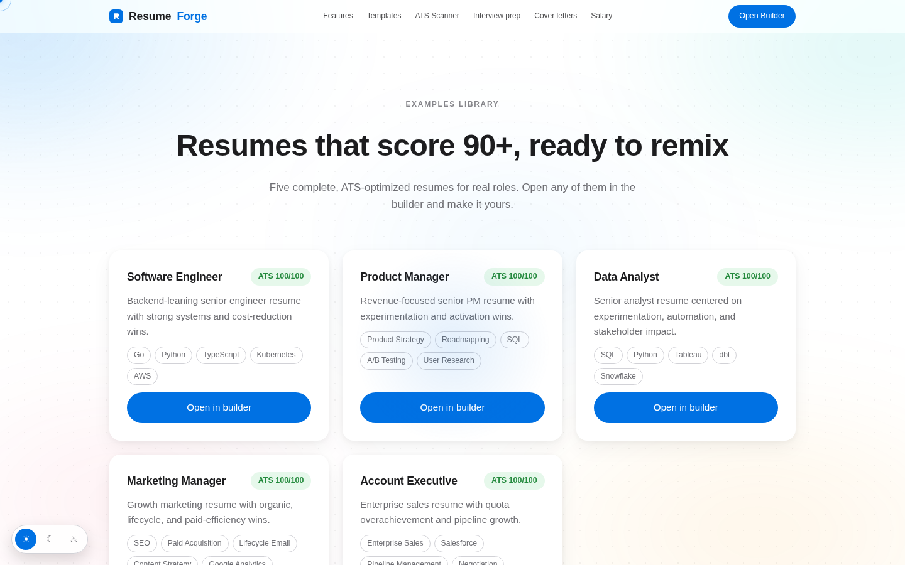 **Examples Library** — 5 complete role resumes, all scoring 100/100, one-click open in the builder | 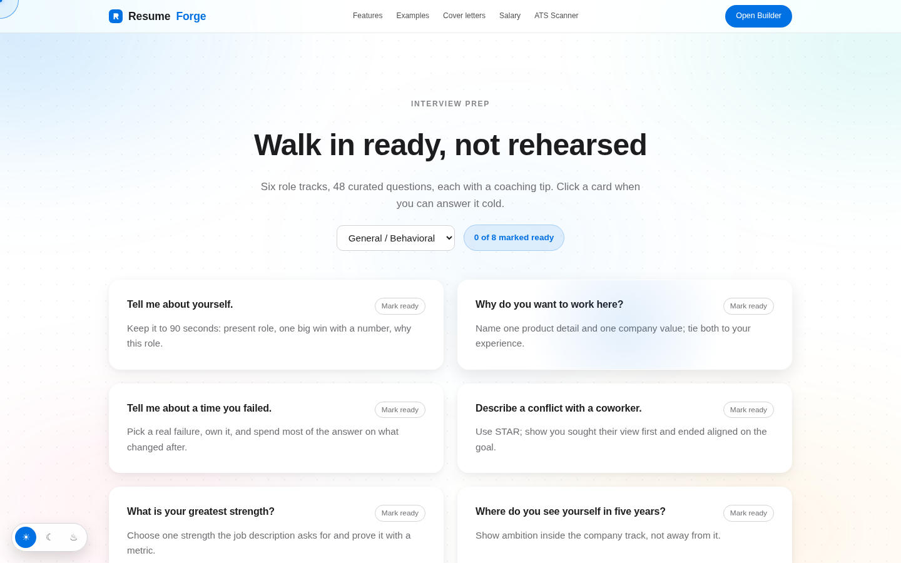 **Interview Prep** — 48 questions across 6 role tracks with coaching tips and a readiness counter |
| 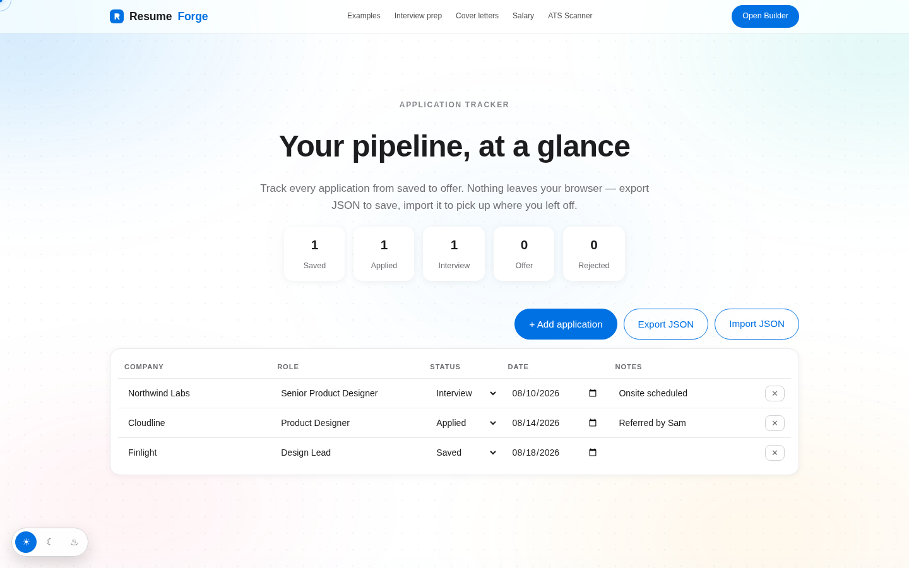 **Application Tracker** — pipeline stages, inline editing, JSON export/import | 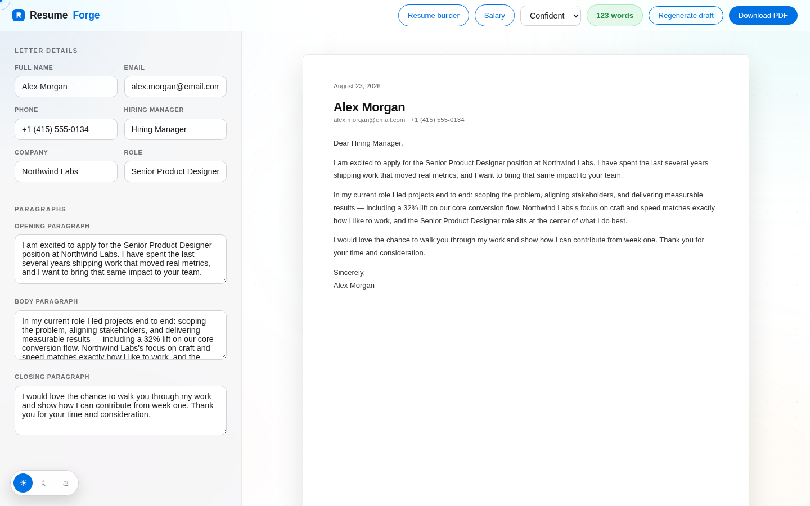 **Cover Letter Studio** — 3 tone presets, live preview, word-count meter, PDF export |

---

## Three Themes

A floating pill (bottom-left of every page) switches between **☀ Light**, **☾ Dark**, and **♨ Warm** — a cozy cream-and-amber palette with burnt-orange accents. The choice persists across pages and reloads via a lightweight cookie, and the resume paper stays print-white in every theme.

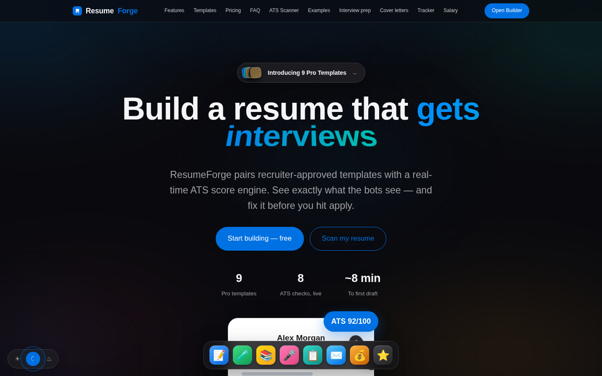

---

## The Scoring Engines

Four pure, node-testable modules (no DOM):

**Builder engine — `js/ats.js` · 8 checks · 100 pts**

| Check | Pts | Check | Pts |
| --- | --- | --- | --- |
| Contact info complete | 10 | Quantified achievements | 15 |
| Strong summary (60–500 chars) | 15 | Action verbs (3+) | 10 |
| 6+ relevant skills | 15 | Education listed | 10 |
| 2+ experience entries | 20 | Location provided | 5 |

**Scanner engine — `js/parse.js` · 10 checks · 100 pts** — contact (15), experience/education/skills sections (10 each), summary (5), quantified achievements (15), action verbs (10), healthy length (10), bullet formatting (10), minimal first-person pronouns (5).

**Keyword matcher — `js/match.js`** — extracts the top 18 JD terms through a stop-word filter and reports matched vs. missing with a coverage %.

**Salary engine — `js/salarylib.js`** — raise %, market delta, verdict (strong / fair / below), a counter range anchored 8–18% above the stronger of offer vs. market, and 4 templated negotiation scripts.

---

## Architecture

Pure **HTML + CSS + vanilla JS**. No frameworks, no build step, no runtime CDN calls — GSAP, ScrollTrigger, pdf.js, brand icons, and fonts are all vendored locally.

```
resumeforge/
├── index.html            # Landing: hero, compare, wall, marquees, dock, pricing
├── builder.html          # Builder + ATS + JD match + bullet doctor + keyboard
├── scan.html             # Upload/paste ATS scanner
├── salary.html           # Offer analyzer + negotiation scripts
├── examples.html         # 5 role resumes
├── interview.html        # 48-question prep studio
├── tracker.html          # Application pipeline
├── coverletter.html      # Cover letter studio
├── css/                  # Apple-language design system (per-page + components)
├── js/
│   ├── ats.js            # 8-check structured scorer        (pure)
│   ├── parse.js          # 10-check raw-text scorer         (pure)
│   ├── match.js          # JD keyword matcher               (pure)
│   ├── salarylib.js      # Offer analyzer + scripts         (pure)
│   ├── bulletlib.js      # Per-bullet analyzer              (pure)
│   ├── coverlib.js       # Tone-based letter generator      (pure)
│   ├── components.js     # 15-component interaction layer
│   ├── theme.js          # Light/Dark/Warm + cookie persistence
│   ├── fx.js             # Cursor system + magnetic buttons
│   ├── motion.js         # ScrollTrigger choreography + tilt cards
│   ├── dock.js           # macOS dock + social pill
│   ├── keyboard.js       # Mechanical keyboard + physics
│   └── …page controllers + data
├── vendor/               # gsap, ScrollTrigger, pdf.js, icons, fonts
├── tests/
│   ├── logic.test.js     # Pure-module suite
│   ├── salary.test.js    # 15 salary-engine assertions
│   └── e2e.js            # 15-check Playwright suite, all pages
└── docs/                 # README assets
```

---

## Getting Started

```bash
git clone https://github.com/D-L-Narayana/resumeforge.git
cd resumeforge
python3 -m http.server 8080     # any static server works
# open http://localhost:8080
```

No install. No build. No environment variables.

---

## Testing

```bash
node tests/logic.test.js    # engines, matcher, doctor, data integrity
node tests/salary.test.js   # salary engine: analyzer + scripts
node tests/e2e.js           # Playwright: 15 assertions across all pages
```

All three suites are green on `main`.

---

## Roadmap

- Resume text importer (paste → structured fields)
- Custom template accent colors
- Cover letter A/B variants
- LinkedIn profile export

---

## License

Released under the [MIT License](LICENSE).

<div align="center">


**ResumeForge** — crafted for job seekers.

</div>
